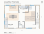
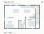

# Print Studio + ADU

A building with an artist's print studio and an accessory dwelling unit (ADU).
This is concept v1, a starting point to react to. It is not for construction.

**Concept v1:** a two-storey, 36' × 24' carriage-house type. The print studio is on the
ground floor (slab on grade for the press, an 8' loading door, tall north windows, and a
separate wet/etch room with a fume hood). A one-bedroom ADU sits above, reached by its
own enclosed stair and entry.

**Exterior walls:** 8" double-stud walls (two rows of 2x4s at 24" o.c. with a 1" gap)
filled with dense-pack cellulose, about R-30 nominal. With 1/2" sheathing and 1/2"
drywall they are 9" thick overall. The 36' × 24' footprint is measured to the outside of
the sheathing.




## Viewing the model with free tools

| File | Open it with |
| --- | --- |
| `output/viewer.html` | Any web browser. Download it and double-click. It has an orbitable 3D model, section cut, layer toggles, floor plans, and the brief. It needs internet access to load three.js. |
| `output/building.stl` | Click it on GitHub to get an interactive 3D preview in the browser. |
| `output/building.glb` | Windows 3D Viewer, macOS Preview / Quick Look, Blender, or drag it onto <https://gltf-viewer.donmccurdy.com>. Colours and transparency are kept. |
| `output/building.obj` | Blender, SketchUp (via import), most 3D tools. |
| `output/plan-*.svg` | Any browser, Inkscape, Illustrator. |
| `output/building.3dm` | **Rhino** (later). Units are feet, with one layer per building system. It also opens in Blender with the free *Import Rhinoceros 3D* add-on, and in the free online viewer at <https://www.rhino3d.com/viewer/>. |

## Changing the design

Every output is generated from one file, `model/design.py`. Change a number there (the
footprint, floor heights, roof pitch, window positions, the press location) and rebuild:

```sh
pip install -r requirements.txt
python build.py
```

| Path | What it is |
| --- | --- |
| `model/design.py` | The design: dimensions, walls, openings, rooms, equipment. |
| `model/walls.py` | The exterior wall assembly (layers, stud rows, framing). |
| `model/geometry.py` | Primitives (boxes, extruded profiles, walls with openings). |
| `model/export.py` | Writers for `.3dm`, `.glb`, `.obj`, `.stl`, SVG plans, viewer data. |
| `viewer/template.html` | The browser viewer (three.js). |
| `build.py` | Runs everything and writes `output/`. |

Coordinates are in feet. x points east, y points north, z points up. The origin is the
building's southwest corner at the top of the ground-floor slab.

## Rhino notes for later

* Every object is a closed extrusion, named (for example "Etching press bed",
  "Living south window") and placed on a layer: Walls-Ext-Sheathing, Walls-Ext-Cellulose,
  Walls-Ext-Framing (every stud, plate, header and rim), Walls-Ext-Drywall, Walls-Interior, Floors,
  Roof, Glazing, Doors, Stair, Studio-Equipment, Studio-Zones, ADU-Furniture, Slab, Site.
* Walls are split into pieces around openings. In Rhino, `BooleanUnion` per wall merges
  them if you want single solids.
